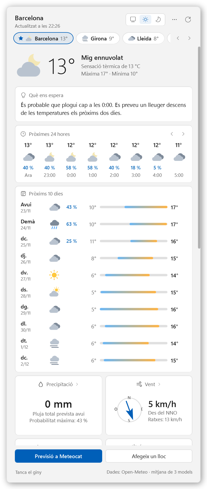
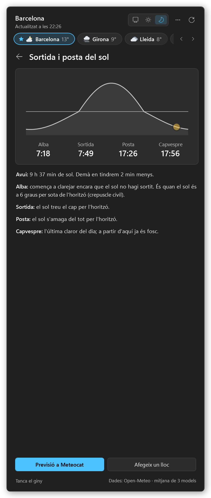

# Quina Barra!

*El temps del teu poble a la barra de tasques, en català.*

Giny per a Windows 11 que posa **el temps del teu poble** a l'esquerra de la barra de tasques, on hi havia el giny del temps de Hasefroch (sí, aquell que de vegades et parla en àrab), però **en català** i sense notícies ni anuncis.



**[⬇ Baixa la darrera versió](https://github.com/PepPepet/quina-barra/releases/latest)** · un sol fitxer, `QuinaBarra.exe`, sense instal·lador.

<p>
  
  
</p>

## Què fa

- **Temps d'ara a la barra**: icona, temperatura i estat del cel, sempre visibles.
- **Tu tries els llocs** (pobles, ciutats o barris) i en pots desar uns quants. No es fa servir mai la IP, que sovint diu que ets a una altra banda.
- **Temperatura més fiable**: mitjana de tres models (Météo-France, ICON i ECMWF).
- **Què ens espera**: un resum en una frase de la pluja de les pròximes hores i de la tendència de les temperatures.
- **Pròximes 24 hores** i **pròxims 10 dies**.
- **Rajoles** de precipitació, vent, sortida i posta del sol, índex UV, qualitat de l'aire (escala oficial ICA), visibilitat, humitat i pressió. Cada rajola obre una **pàgina de detall** amb gràfic per hores i explicació.
- **Mar**, als llocs de costa: onades, període, mar de fons, temperatura de l'aigua i l'estat de les platges (bandera, meduses, transparència).
- **Radar de pluja** de les últimes 2 hores, animat, sobre un mapa d'OpenStreetMap.
- **Personalitza el panell**: tria quins blocs vols veure i en quin ordre. El que amaguis ja no es baixa d'internet.
- Als municipis de Catalunya, enllaç directe a la previsió de **Meteocat**.
- Mode clar, fosc o com el Windows. S'amaga quan mires un vídeo a pantalla completa.
- Lleuger: uns 100 MB de memòria i pràcticament gens de processador.

<p>
  
  
  
</p>

## Com s'instal·la

1. Baixa `QuinaBarra.exe` de la [pàgina de la darrera versió](https://github.com/PepPepet/quina-barra/releases/latest) i desa'l on vulguis (per exemple, a `C:\Users\<el teu usuari>\QuinaBarra`).
2. Fes-hi doble clic. Com que el programa no té una signatura digital de pagament, Windows pot mostrar **«Windows ha protegit l'ordinador»**: prem **Més informació** → **Executa igualment**.
3. El primer cop et demanarà el teu lloc.
4. Perquè s'engegui sol: menú **⋯** → **Quant a** → marca **Engega amb el Windows**.

Un cop al dia mira si hi ha una versió nova. No la baixa ni la instal·la pel seu compte: t'avisa i obre la pàgina de GitHub de la versió nova.

## Com es fa servir

- **Clic** al giny: obre el panell. **Clic** a una rajola: n'obre el detall. Per tornar: la fletxa ←, la tecla Esc o el botó lateral «enrere» del ratolí.
- **Pastilles de llocs**: un clic hi salta; **+ Afegeix** en desa un de nou; amb el **botó dret** el pots fer principal, canviar-li el nom, moure'l o treure'l. El principal (★) és el que surt a la barra.
- **Menú ⋯**: Personalitza el panell, Quant a i Tanca el giny.

## On desa les coses i com es desinstal·la

La configuració és a `%APPDATA%\QuinaBarra\` (`config.json`, una còpia `config.bak` i un registre petit `registre.log`).

Per desinstal·lar-lo: desmarca **Engega amb el Windows**, tria **Tanca el giny** i esborra `QuinaBarra.exe` i la carpeta `%APPDATA%\QuinaBarra`.

## Privadesa

No recull cap dada teva. Només envia les coordenades dels llocs que has desat als serveis del temps per demanar-ne la previsió. La configuració es queda al teu ordinador.

## D'on surten les dades

- Previsió, qualitat de l'aire i mar: [Open-Meteo](https://open-meteo.com/) (CC BY 4.0), amb models de Météo-France, DWD (ICON), ECMWF i Copernicus (CAMS). El cercador de llocs és el geocodificador d'Open-Meteo (basat en GeoNames).
- Qualitat de l'aire classificada amb l'escala oficial **ICA** del [MITECO](https://www.miteco.gob.es/ca/calidad-y-evaluacion-ambiental/temas/atmosfera-y-calidad-del-aire/visualizacion-datos-calidad-del-aire/ica.html): partícules en mitjana de 24 h, ozó de 8 h, NO₂ i SO₂ de la darrera hora.
- Noms i codis oficials dels municipis de Catalunya: [Idescat](https://www.idescat.cat/).
- Estat de les platges: [dades obertes de la Generalitat](https://analisi.transparenciacatalunya.cat/d/4baz-cjv2) (només en temporada de bany; fora de temporada es mostra l'últim estat amb la data).
- Radar: [RainViewer](https://www.rainviewer.com/).
- Mapa: © [col·laboradors d'OpenStreetMap](https://www.openstreetmap.org/copyright). Les rajoles es desen al disc 30 dies per no sobrecarregar els seus servidors.

## Compilar-lo tu mateix

El codi font és a `src\` (C#, .NET Framework 4.8, que ja porta el Windows). No cal instal·lar res:

```powershell
powershell -NoProfile -ExecutionPolicy Bypass -File src\build.ps1
```

L'`.exe` surt a `exe\QuinaBarra.exe`. Amb `QuinaBarra.exe /prova <carpeta>` en fa captures de totes les pantalles sense tocar la configuració.

Els suggeriments i els errors, a les [incidències](https://github.com/PepPepet/quina-barra/issues), en català.

## Autoria i llicència

Fet per [Pep Payo](https://peppayo.com) amb l'ajuda de Claude, la IA d'Anthropic.

Codi obert amb **llicència MIT** (vegeu el fitxer [LICENSE](LICENSE)): el pots fer servir, copiar, modificar i compartir lliurement, sempre que hi mantinguis l'avís d'autoria. Es dona tal qual, sense cap garantia.
